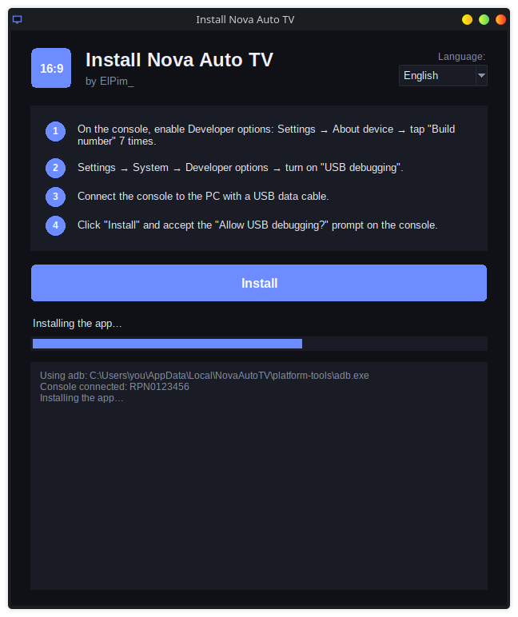

<div align="center">

# 📺 Retroid Pocket Nova — Automatic 4:3 → 16:9 Dock Mode

**Plug your Retroid Pocket Nova into a TV and the screen switches to 16:9 by itself.
Unplug it and it goes back to 4:3.**

No root · No Tasker · No Shizuku · One click installer for Windows

[](https://github.com/ErikRomellon/retroid-pocket-nova-auto-16-9-dock-mode/releases/latest)

Created by **ElPim_**



</div>

---

## ✨ What it does

The Retroid Pocket Nova has a 4:3 screen. When you connect it to a TV over HDMI, the picture
looks squashed or gets black bars. **Nova Auto TV** fixes that automatically:

| Event | What the app does |
| --- | --- |
| 🔌 TV connected (HDMI) | Switches the resolution to **16:9** (`1080x1920`) |
| ❌ TV disconnected | Restores the original **4:3** screen |
| 🔄 Console restarted | Starts again by itself, nothing to do |

The app is available in **English, Español, Português and Français**. It follows the system
language, and you can also pick one by hand.

---

## 🚀 Easy install (Windows, no programming needed)

### 1. Download

Go to **[Releases](https://github.com/ErikRomellon/retroid-pocket-nova-auto-16-9-dock-mode/releases/latest)**
and download **`NovaAutoTV-v3.0.zip`**. Unzip it. Inside you will find:

| File | What it is for |
| --- | --- |
| `NovaAutoTV-Install.exe` | Installs the app on the console and gives it the permission it needs |
| `NovaAutoTV-Uninstall.exe` | Removes everything (restores the screen, uninstalls the app, cleans the PC) |
| `NovaAutoTV.apk` | The app itself, in case you prefer to install it by hand |

### 2. Prepare the console (only once)

> [!IMPORTANT]
> The installer talks to the console over USB, so you **must** turn on USB debugging first.

1. **Enable Developer options:** open *Settings → About device* and tap **Build number**
   **7 times**, until you see *"You are now a developer"*.
2. **Enable USB debugging:** open *Settings → System → Developer options* and turn on
   **USB debugging**.

### 3. Install

1. Connect the console to the PC with a USB **data** cable (some cables only charge).
2. Run **`NovaAutoTV-Install.exe`**, choose your language and click **Install**.
3. On the console, accept the **"Allow USB debugging?"** prompt. Tick *Always allow from this
   computer*.
4. When the installer finishes, **Nova Auto TV** opens on the console. Turn on **Service active**.

That's it. The permission survives reboots, so you never have to connect it to the PC again.

> [!NOTE]
> **Windows SmartScreen** may warn you because the `.exe` is not signed. Click
> **More info → Run anyway**.
>
> If the installer can't find the console, try another cable or USB port and check that USB
> debugging is on. If it still doesn't show up, install the
> [Google USB driver](https://developer.android.com/studio/run/win-usb).

### Uninstall

Connect the console with USB debugging on and run **`NovaAutoTV-Uninstall.exe`**. It restores
the screen, removes the app from the console and deletes the files the installer downloaded
to your PC (`%LOCALAPPDATA%\NovaAutoTV`).

### Using the app

- **Resolution** and **delay** (2000 ms by default) can be changed. Press **Save** afterwards.
- **Apply 16:9**, **Restore 4:3** and **Show wm size** let you test without a TV.
- A small notification shows the current state.

---

## 🐍 Install with Python (Linux / macOS / Windows)

If you'd rather not use the `.exe` files, you can install the APK with
[adb](https://developer.android.com/tools/releases/platform-tools) yourself (after enabling
Developer options and USB debugging as described above):

```sh
adb install -r NovaAutoTV.apk
adb shell pm grant com.retroid.novaautotv android.permission.WRITE_SECURE_SETTINGS
```

Or build everything from source and install it in one go:

```sh
git clone https://github.com/ErikRomellon/retroid-pocket-nova-auto-16-9-dock-mode.git
cd retroid-pocket-nova-auto-16-9-dock-mode
python3 retroid_pocket_nova_android_automatic16-9_automatic_tv.py --install --no-exe
```

---

## 🛠️ For developers

Everything is generated by **one Python script** that only uses the standard library:
`retroid_pocket_nova_android_automatic16-9_automatic_tv.py`. It contains the Android app source
and the Windows installer as embedded templates.

```sh
python3 retroid_pocket_nova_android_automatic16-9_automatic_tv.py
```

This builds into `dist/`:

- `NovaAutoTV.apk`
- `NovaAutoTV-Install.exe` (with the APK bundled inside)
- `NovaAutoTV-Uninstall.exe`

Missing dependencies are downloaded automatically into `./.toolchain/`: JDK 17 (Temurin, only if
there's no JDK 17+ on your PATH), Android SDK, Gradle and `adb`. To build the `.exe` files it also
installs Windows Python + PyInstaller inside its own wine prefix, so **wine** must be installed on
the system (Linux). Without wine, the script prints a warning and only builds the APK.

| Option | What it does |
| --- | --- |
| *(none)* | Builds the APK and both `.exe` files |
| `--no-exe` | Builds only the APK |
| `--install` | Also installs the APK over `adb` and grants `WRITE_SECURE_SETTINGS` |
| `--grant` | Only grants the permission to the already installed app |
| `--debug` | Builds the debug variant |
| `--clean` | Deletes `android_project/`, `build_exe/` and `dist/` before building |
| `--uninstall` | Console: `wm size reset` + uninstalls the app. PC: deletes `.toolchain/`, `android_project/`, `build_exe/` and `dist/`. Asks for confirmation |
| `--yes` | With `--uninstall`, skips the confirmation |

### Android source

`android_project/` contains the Gradle project for the APK (Java, no external apps). It is
**generated by the script** and included here so you can read it or open it in Android Studio.
If you want to change something, edit the templates in the script, because the folder is
overwritten on every build.

The signing key is created on first build in `.toolchain/release.jks` and is **not** part of the
repo. An APK built by you is signed with your own key, so it can't update an installation made
with the official release: uninstall that one first.

### How it works

- It detects the TV with the `ACTION_HDMI_AUDIO_PLUG` broadcast. As a fallback, it checks for an
  external *presentation* display.
- When the state changes, it waits for the configured delay and calls
  `IWindowManager.setForcedDisplaySize` / `clearForcedDisplaySize`, which is exactly what
  `wm size` does internally. The system only requires `WRITE_SECURE_SETTINGS`, which can be granted
  once over adb. The hidden API is accessed with
  [`org.lsposed.hiddenapibypass`](https://github.com/LSPosed/AndroidHiddenApiBypass), bundled
  inside the APK.

If the screen ever gets stuck at a wrong size: `adb shell wm size reset`.

---

<div align="center">

Made with ❤️ by **ElPim_**

</div>
